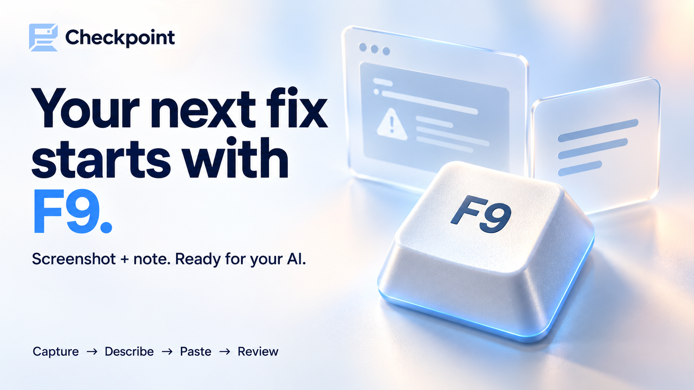

# Checkpoint



Capture issues. Turn them into to-dos. Work through them with your assistant.

Checkpoint is a Windows app for recording bugs, design changes and feature ideas in games, apps or anything else on your screen. Save a screenshot with a typed or dictated note, then send it to Codex or Claude to work through.

It runs quietly in the background until you need it. Capturing and reviewing tasks works locally, without AI tokens, internet or a server.

## Get started

You'll need **Windows 10/11** and **Python 3.11 or newer**.

1. Download this repository and unzip it.
2. Open PowerShell in the extracted folder and run this once to install dependencies:

   ```powershell
   powershell -ExecutionPolicy Bypass -File setup.ps1
   ```

3. Double-click **start.cmd**.
4. Hold **F9** and choose or create a project to group your captures.

Next time, just double-click **start.cmd**. Closing the review window leaves Checkpoint running in the system tray. Use **Quit** in the tray to exit.

## Capture and review

| Control | Action |
|---|---|
| Tap **F9** | Save a screenshot as an open task. |
| Double-tap **F9** | Reopen the last task to edit it. |
| Hold **F9** | Open the main menu to review your tasks. |
| Tap, release, then quickly hold **F9** | Save a screenshot and voice note. Speak during the hold; release to save. |

Type a note or click **Dictate note**, then **Save**. For voice notes, enable your microphone in **Settings → Audio** and download the speech model in **Settings → Transcript**.

- Click the **pencil** to edit a task or its screenshots.
- Drag **up** to mark Done or **down** to delete. **Undo** restores the change.
- **Shift** selects a range; **Ctrl-click** adds or removes individual tasks.

For continuous recording, configure audio in **Settings → Audio** and use the record button beside Settings. Right-click it to open transcripts.

## Work through your tasks

- **Copy images:** Click the **copy button** beside the pencil, then paste into your chat. It copies all selected tasks, including their screenshots and notes.
- **Connect directly:** Connect Codex or Claude Desktop in **Settings → Chat**, restart that app, then ask: “List my open Checkpoint tasks.”

Work through the tasks with your assistant, check the changes, then mark them **Done** in Checkpoint. The direct connection is read-only.

## License

Copyright (C) 2026 Bligh Hedges. [GNU Affero General Public License v3 or later](LICENSE).
