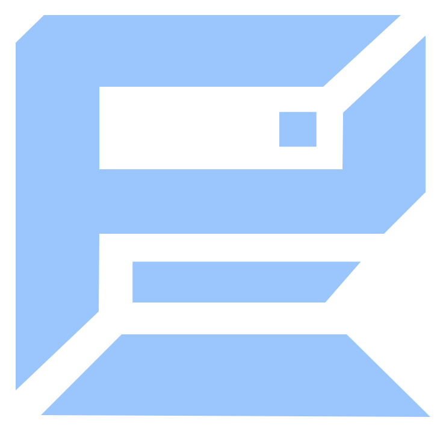

<p align="center">
  
</p>

# Checkpoint

Capture issues. Turn them into to-dos. Work through them with your assistant.

Checkpoint is a Windows app for recording bugs, design changes and feature ideas in games, apps or anything else on your screen. Save a screenshot with a typed or dictated note, then send it to Codex or Claude to work through.

It runs quietly in the background until you need it. Capturing and reviewing tasks works locally, without AI tokens, internet or a server.

## Get started

You'll need **Windows 10/11** and **Python 3.11 or newer**.

1. Download this repository and unzip it.
2. Open PowerShell in the extracted folder and run this once to install dependencies:

   ```powershell
   powershell -ExecutionPolicy Bypass -File setup.ps1
   ```

3. Double-click **start.cmd**.
4. Hold **F9** and choose or create a project to group your captures.

Next time, just double-click **start.cmd**. Closing the review window leaves Checkpoint running in the system tray. Use **Quit** in the tray to exit.

## Capture and review

| Control | Action |
|---|---|
| Tap **F9** | Save a screenshot as an open task. |
| Double-tap **F9** | Reopen the last task to edit it. |
| Hold **F9** | Open the main menu to review your tasks. |
| Tap, release, then hold **F9** | Capture on the first tap and record a voice note during the second hold. Release to save (up to 60 seconds). |

Popups open on the display containing your mouse pointer, including the note editor, review menu, settings and notifications.

To record a voice note, **tap F9 and release it, then quickly press F9 again and hold it while speaking**. Release the second press to stop recording and save the voice note. The screenshot comes from the first tap.

**Holding F9 on its own opens the main menu**, replacing the previous triple-tap shortcut.

In the note window, type or click **Dictate note**, then **Save**. Double-tap **F9** any time to edit the last task again, or click **Open menu** in the editor to review your tasks. Closing an edited task keeps your written changes. For dictation, first enable your microphone in **Settings → Audio** and download the speech model in **Settings → Transcript**. It runs offline after download.

To capture what you're saying as you test, choose your microphone and/or computer audio in **Settings → Audio**, then click the circular record button beside Settings in review, or start recording from the tray. The button turns red while recording; click it again to stop. With transcription enabled, nearby speech is added to your screenshots automatically. Recording is optional.

In review, the task text stays visible in a frosted caption along the bottom of each screenshot card. Click the copy button beside the pencil to copy the full task PNG, then paste it into your chat. With multiple tasks selected, it copies all selected PNG files. Click the pencil to edit notes or screenshots, drag a task **up to mark Done**, or **down to delete**. Deleted tasks can be reopened.

Hold **Shift** while clicking a card or pressing **← / →** to select a range. Hold **Ctrl** and click to add or remove individual cards. Drag a selected card up or down to finish or delete the whole selection; **Undo** restores the group. Shift-click **Oldest** or **Newest** to select through that end of the deck.

Click outside the main review menu to hide it. Note, screenshot-edit and settings windows stay open. Opening task images also hides review so the folder is visible.

When session transcription is enabled, all recorded speech is saved in a UTF-8 text file named after the session, including speech without screenshots. Live transcription updates the file while recording; **After recording** fills it once the session ends. Right-click the record button for **Transcript history → Open transcript**, or **Open transcripts folder**. The files live under `transcripts/<session-id>/<session-name>.txt` in your data folder, with timestamps and audio-source labels. You can give this file to your assistant to find more tasks.

Use **Add to last task** in the editor to combine the current task with the preceding open task in the same project. You can also snip another image into the task, then edit or remove its images individually.

## Work through your tasks

- **Use images:** Click **Open task images** and drag a task’s PNG into Codex, Claude or your preferred chat. Each task has one PNG containing all of its numbered images and notes.
- **Connect directly:** Connect Codex or Claude Desktop in **Settings → Chat**, restart that app, then ask: “List my open Checkpoint tasks.”

Work through the tasks with your assistant, check the changes, then mark them **Done** in Checkpoint. The direct connection is read-only.

Your data stays in `%LOCALAPPDATA%\Checkpoint`, with task images in its `images` folder. You choose what to share.

## License

Copyright (C) 2026 Bligh Hedges. [GNU Affero General Public License v3 or later](LICENSE).
