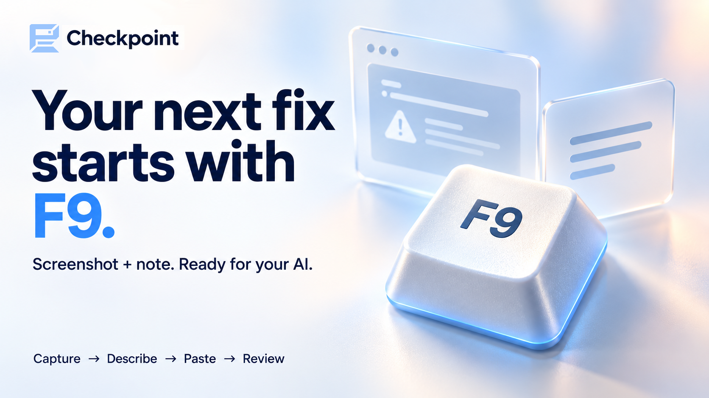

# Checkpoint

[](https://youtu.be/uFSvx3V0-0w)

[▶ Watch the Checkpoint demo on YouTube](https://youtu.be/uFSvx3V0-0w)

Capture issues. Turn them into to-dos. Work through them with your assistant.

Checkpoint is a Windows app for recording bugs, design changes and feature ideas in games, apps or anything else on your screen. Save a screenshot with a typed or dictated note, then send it to Codex or Claude to work through.

It runs quietly in the background until you need it. Capturing and reviewing tasks works locally, without AI tokens, internet or a server.

## Get started

You'll need **Windows 10/11** and **Python 3.11 or newer**.

1. Download this repository and unzip it.
2. Open PowerShell in the extracted folder and run this once to install dependencies:

   ```powershell
   powershell -ExecutionPolicy Bypass -File setup.ps1
   ```

3. Double-click **start.cmd**.
4. Hold **F9** and choose or create a project to group your captures.

Next time, just double-click **start.cmd**. Closing the review window leaves Checkpoint running in the system tray. Use **Quit** in the tray to exit.

## Capture and review

| Control | Action |
|---|---|
| Tap **F9** | Save a screenshot as an open task. |
| Double-tap **F9** | Reopen the last task with a temporary screenshot draft. |
| Hold **F9** | Open the main menu to review your tasks. |
| Tap, release, then quickly hold **F9** | Save a screenshot and voice note. Speak during the hold; release to save. |

When F9 opens a capture without dictation, the note box is focused so you can type immediately. The Marker stays selected; click the image to draw. You can also click **Dictate note**, then **Save**. For voice notes, enable your microphone in **Settings → Audio** and download the speech model in **Settings → Transcript**.

Captures open the editor immediately by default. Turn **Settings → General → Show capture editor immediately** off to capture without opening it, or on to review, annotate, and add notes as you capture. The option sits above automatic clipboard copying.

Double-tap **F9** to edit the last task and take another screenshot as a **Draft · click to add** tab. The previous image stays selected. Click the draft tab to keep the screenshot and start editing it; click its **×** to discard it immediately. Unaccepted drafts stay temporary, are replaced on the next edit, and are dropped when the editor closes. They never appear in copied task images or clipboard copies until you click to add them.

- Click the **pencil** or double-tap **F9** to open the same capture workspace: image tabs and drawing tools beside the note and transcript. There is no separate image-editing step or category picker.
- Start drawing immediately with the **red 12 px Marker**, or choose **Highlighter**, **Shapes**, **Text**, or **Eraser**. Shapes starts with a **red 12 px Arrow**; Highlighter defaults to **20 px**. Image tabs retain unsaved drawings and crops while you switch between them.
- Click **+** beside the image tabs to take another screenshot. Click an image's **×** to delete it after confirmation; the note and remaining images stay.
- Select **Crop**, drag the area to keep, and press **Enter** or click **Apply crop** to enlarge it in the editor. Use **+**, **−**, or **Fit** to change the zoom. **Undo/Redo** (Ctrl+Z / Ctrl+Y) works across annotations and crops.
- Click **Save** (Ctrl+S) to save the note and all edited images together. **Discard task** moves the task to Deleted after confirmation. **Restore original** previews the untouched screenshot; save to keep the restoration.
- Tapped **F9** once when you meant to add context to your last task? Click **Add to previous task** beside Save. It combines the new screenshot, note and voice recording with the preceding open task in this project. If speech is still processing, it finishes the transcript first.
- The sidebar shows **Listening** while you speak and **Transcribing** after you stop; the current speech model produces the transcript after recording. Keep typing or drawing while it processes. Saving during recording stops it and waits for the transcript before saving your combined note and images.
- Drag **up** to mark Done or **down** to delete. **Undo** restores the change.
- **Shift** selects a range; **Ctrl-click** adds or removes individual tasks.
- Select two or more tasks to show **Merge selected tasks** in the menu. It combines only your selection into the oldest selected task, appending notes and attachments in creation order. The other selected cards disappear into that task.

Checkpoint keeps item text and transcripts. By default it removes images and audio **1 day after deletion** or **7 days after Done / archived**, replacing the image with a red or green glass placeholder. Change either period (or choose **Keep forever**) in **Settings → Storage**. Cleanup runs at startup on existing items and hourly while the app is open. Reopening an item before cleanup keeps its attachments; Undo after cleanup restores the text-only item. Attachments still used by another retained item are kept until that item is eligible too.

For continuous recording, configure audio in **Settings → Audio** and use the record button beside Settings. Right-click it to open transcripts.

## Work through your tasks

- **Copy images:** Click the **copy button** beside the pencil, then paste into your chat. It copies all selected tasks, including their screenshots and notes.
- **Paste the latest task:** After saving a capture or processing its voice note, Checkpoint automatically adds the complete task image to your clipboard and shows **Added task to clipboard**. Paste straight into Codex or another chat. Saving text or image edits to the latest task refreshes the clipboard too. This is on by default; turn it off or on in **Settings → General → Automatically copy latest task to clipboard**. The menu copy button still copies one task or your whole selection.
- **Connect directly:** Connect Codex or Claude Desktop in **Settings → Chat**, restart that app, then ask: “List my open Checkpoint tasks.”

Work through the tasks with your assistant, check the changes, then mark them **Done** in Checkpoint. The direct connection is read-only.

## License

Copyright (C) 2026 Bligh Hedges. [GNU Affero General Public License v3 or later](LICENSE).


